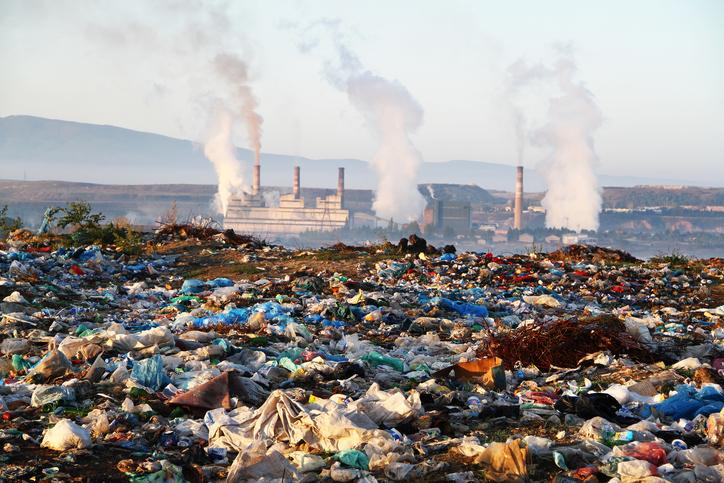

Contaminación ambiental y residuos informáticos
1. Introducción
Actualmente, la informática forma parte de nuestra vida diaria. Utilizamos ordenadores, móviles, impresoras y otros dispositivos tanto para estudiar como para trabajar, comunicarnos o entretenernos. Sin embargo, aunque la tecnología nos ofrece muchas ventajas, también puede tener consecuencias negativas para el medioambiente.

La fabricación de dispositivos electrónicos necesita materias primas, energía y agua. Además, cuando los aparatos dejan de utilizarse, pueden convertirse en residuos que, si no se gestionan correctamente, contribuyen a la contaminación.

En este trabajo analizaremos qué es la contaminación ambiental, cómo se relaciona con la informática, qué residuos generan los dispositivos tecnológicos y qué podemos hacer para reducir su impacto.

2. ¿Qué es la contaminación ambiental?
La contaminación ambiental es la introducción de sustancias o elementos perjudiciales en el medioambiente que alteran su equilibrio natural y pueden afectar a los seres vivos. Puede producirse por actividades humanas como la industria, el transporte, la fabricación de productos y la acumulación de residuos.

Existen diferentes tipos de contaminación:

Contaminación atmosférica: se produce cuando el aire contiene gases o partículas perjudiciales.

Contaminación del agua: ocurre cuando ríos, mares o aguas subterráneas reciben sustancias contaminantes.

Contaminación del suelo: aparece cuando se acumulan residuos o sustancias que perjudican la tierra.

Contaminación acústica: está causada por ruidos excesivos que afectan al entorno y al bienestar de las personas.

La informática también está relacionada con la contaminación ambiental. La fabricación de ordenadores y otros dispositivos requiere extraer materiales, utilizar energía y realizar procesos industriales. Además, el consumo eléctrico de los equipos y la eliminación incorrecta de los aparatos antiguos pueden aumentar su impacto ambiental.

Por ello, es importante utilizar la tecnología de forma responsable, intentar alargar la vida de los dispositivos y evitar desecharlos cuando todavía pueden repararse o reutilizarse.

3. Residuos informáticos
Los residuos informáticos son los dispositivos electrónicos y sus componentes que dejan de utilizarse y se desechan. También se conocen como residuos de aparatos eléctricos y electrónicos (RAEE).

Estos residuos se generan cuando los equipos se estropean, se quedan anticuados, dejan de ser compatibles con determinados programas o son sustituidos por otros nuevos.

Algunos ejemplos de residuos informáticos son:

Ordenadores de sobremesa y portátiles.

Teléfonos móviles y tabletas.

Monitores y pantallas.

Teclados, ratones y otros periféricos.

Impresoras y escáneres.

Cargadores, cables y adaptadores.

Componentes internos, como discos duros, memorias RAM o placas base.

Estos aparatos contienen materiales que pueden aprovecharse mediante procesos de recuperación y reciclaje. Sin embargo, también pueden contener sustancias perjudiciales, por lo que no deben abandonarse ni mezclarse con la basura común.

Cuando los residuos electrónicos se gestionan de forma incorrecta, pueden contaminar el suelo y el agua y provocar daños en el medioambiente. Por eso es necesario llevarlos a instalaciones o puntos de recogida adecuados.

4. Tipos de residuos informáticos
Los residuos informáticos pueden clasificarse según el tipo de dispositivo o componente del que proceden.

4.1. Equipos completos
Incluyen ordenadores de sobremesa, portátiles, servidores y otros equipos que ya no se utilizan. Aunque algunos estén averiados, pueden contener piezas que se aprovechen para reparar otros dispositivos.

4.2. Periféricos
Son los accesorios que se conectan al ordenador, como teclados, ratones, impresoras, escáneres, altavoces y webcams.

4.3. Componentes electrónicos
Son las piezas que forman parte del interior de los equipos, como placas base, procesadores, tarjetas gráficas, memorias RAM y discos duros. Muchos de estos componentes contienen materiales que pueden recuperarse.

4.4. Baterías y cargadores
Las baterías de portátiles, móviles y otros dispositivos deben recogerse de forma separada y gestionarse correctamente. Los cargadores y cables también deben depositarse en los lugares adecuados cuando dejan de funcionar.

4.5. Pantallas y monitores
Los monitores, televisores y pantallas antiguas contienen diferentes materiales y componentes que requieren un tratamiento específico para evitar que sus residuos se gestionen de manera inadecuada.

